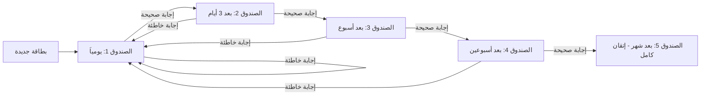
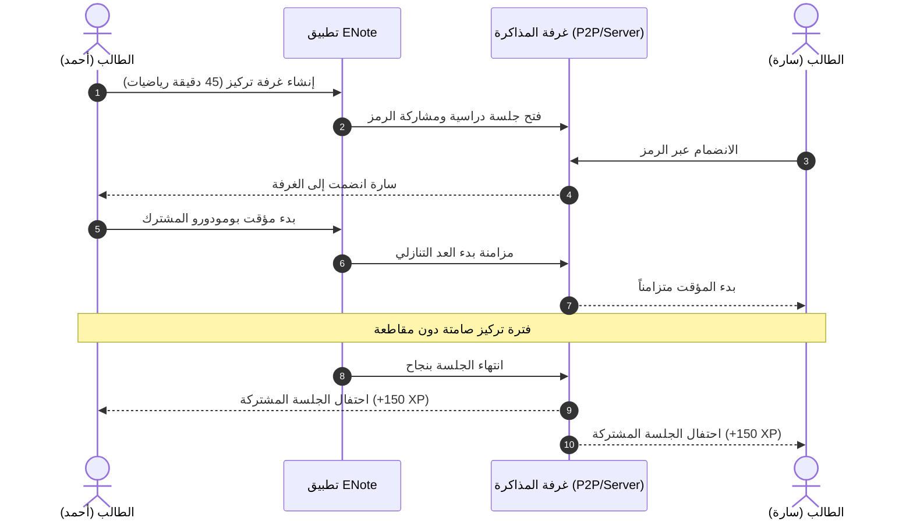
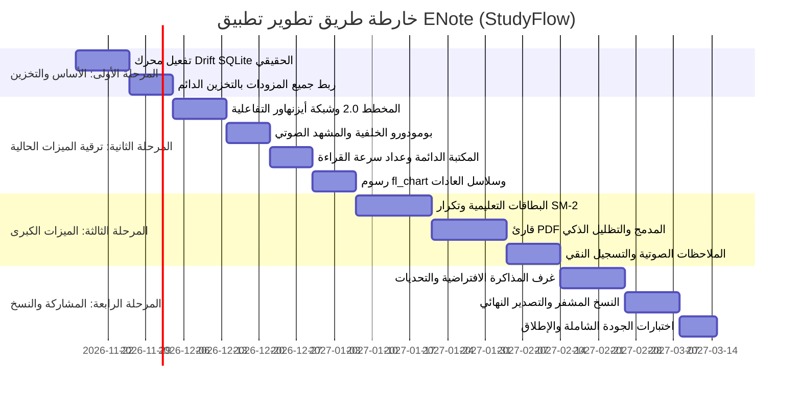

# وثيقة التطوير المعماري وخارطة طريق المنتج
# StudyFlow (ENote) — Product Roadmap & Feature Evolution Plan
**Version:** 2.0.0-PROD  
**Author:** Principal Mobile Product Architect & Feature Strategist  
**Target Platform:** Flutter (Android, iOS, Web, Tablet) | **Architecture:** Feature-First Clean Architecture + Riverpod 2.x + Drift SQLite  
**Design System:** Material 3 with Native Arabic RTL  

---

## الفهرس العام (Table of Contents)
1. [الرؤية الإستراتيجية وهوية المنتج (Strategic Vision & Product Identity)](#1-الرؤية-الإستراتيجية-وهوية-المنتج)
2. [التدقيق الشامل للميزات الحالية وسجل الفجوات (Comprehensive Audit & Gap Analysis)](#2-التدقيق-الشامل-للميزات-الحالية-وسجل-الفجوات)
   - 2.1 المخطط اليومي والمهام الذكية (Daily Planner & Tasks)
   - 2.2 مؤقت بومودورو ومنظومة التركيز (Pomodoro Focus Timer)
   - 2.3 مكتبة المواد والكتب (Materials & Books Library)
   - 2.4 الأهداف والمحطات الذكية (Goals & Milestones)
   - 2.5 متتبع العادات ومصفوفة الاستمرارية (Habits Matrix)
   - 2.6 الملاحظات وقاعدة المعرفة (Notes & Knowledge Base)
   - 2.7 التحليلات والإحصائيات الدراسية (Statistics & Analytics)
   - 2.8 التحفيز والمكافآت (Gamification & Rewards)
   - 2.9 التهيئة والملف الشخصي وتخزين البيانات (Onboarding, Profile & Persistence)
3. [خطة الارتقاء بالميزات القائمة — الإصدار 2.0 (Existing Features Elevation Plan)](#3-خطة-الارتقاء-بالميزات-القائمة--الإصدار-20)
4. [الميزات الخمس الكبرى القادمة (5 High-Value Next-Gen Flagship Features)](#4-الميزات-الخمس-الكبرى-القادمة)
   - 4.1 نظام البطاقات التعليمية والتكرار المتباعد (Spaced Repetition & Leitner Box)
   - 4.2 قارئ الكتب وPDF المدمج مع التظليل الذكي (In-App PDF Reader & Smart Annotations)
   - 4.3 الملاحظات الصوتية والتفريغ التلقائي للمحاضرات (Voice Notes & Audio Transcription)
   - 4.4 غرف المذاكرة الجماعية والتحديات الدراسية (Virtual Study Rooms & Peer Challenges)
   - 4.5 النسخ الاحتياطي المشفر والمزامنة غير المتصلة (Offline Encrypted Backup & Sync)
5. [المعمارية التقنية وهندسة البيانات (Technical Architecture & Data Engineering)](#5-المعمارية-التقنية-وهندسة-البيانات)
   - 5.1 طبقات الكود ونمط Feature-First Clean Architecture
   - 5.2 مخطط قاعدة البيانات Drift SQLite Schema V2
   - 5.3 إدارة الحالة المتقدمة عبر Riverpod 2.x
6. [دليل تجربة المستخدم والتصميم البصري (UI/UX Polish & Design System)](#6-دليل-تجربة-المستخدم-والتصميم-البصري)
7. [خارطة الطريق الزمنية ومراحل التنفيذ (Phased Implementation Roadmap & Milestones)](#7-خارطة-الطريق-الزمنية-ومراحل-التنفيذ)
8. [مؤشرات الأداء الرئيسية ونجاح المنتج (Product KPIs & Metrics)](#8-مؤشرات-الأداء-الرئيسية-ونجاح-المنتج)

---

## 1. الرؤية الإستراتيجية وهوية المنتج

### 1.1 هوية التطبيق (ENote / StudyFlow)
**ENote** ليس مجرد تطبيق لإدارة المهام (To-Do List)، بل هو **نظام تشغيل دراسي متكامل (Student Operating System)** صُمم خصيصاً للطلاب العرب في المراحل الإعدادية، الثانوية، والجامعية. يدمج التطبيق الركائز الأربع للإنتاجية الأكاديمية:
1. **التخطيط الزمني الذكي (Time & Energy Planning):** الربط بين المهام وساعة الطالب البيولوجية (Chronobiology).
2. **التركيز العميق (Deep Focus Execution):** جلسات بومودورو معززة بالصوتيات والأمواج الدماغية وعزل المشتتات.
3. **الاستيعاب والتعلم النشط (Active Recall & Knowledge Ingestion):** إدارة الملازم والكتب، البطاقات التكرارية، والملاحظات الذكية.
4. **الالتزام السلوكي والتحفيز (Behavioral Habits & Gamification):** تحويل روتين المذاكرة الشاق إلى مسار ممتع برتب وأوسمة ونقاط خبرة حقيقية.

### 1.2 الفلسفة المعمارية
- **الأولوية للجوال ودعم العرض الموسع (Mobile-First, Adaptive Tablet/Desktop):** تصميم أصيل يلائم شاشات الهواتف مع التكيف السلس للشاشات الكبيرة عبر درجات عرض متجاوبة.
- **التخزين المحلي الصارم دون اتصال (Offline-First Privacy Architecture):** لا يعتمد التطبيق على اتصال الإنترنت للقيام بوظائفه الجوهرية. جميع بيانات الطالب، أوقات مذاكرته، وملخصاته تُحفظ مشفرة على جهازه المحلي عبر SQLite.
- **لغة الضاد أولاً مع هندسة RTL محكمة:** احترام قواعد الخط العربي (Cairo)، الاتجاه من اليمين لليسار، وحساب المسافات ونقاط اللمس بدقة تفوق المعايير العالمية (48dp Touch Targets).

---

## 2. التدقيق الشامل للميزات الحالية وسجل الفجوات

أجرينا تدقيقاً معمقاً عبر الكود المصدري الأصلي في Flutter (`lib/`) والنموذج الأولي في React (`studyflow.tsx`). يوضح الجدول التالي حالة كل ميزة والقصور التقني والوظيفي الحالي:

| الميزة (Feature) | الحالة في React (`studyflow.tsx`) | الحالة في Flutter (`lib/`) | الفجوات والملاحظات المعمارية (Identified Gaps) |
|---|---|---|---|
| **المخطط اليومي والمهام** | قائمة عادية مع تصنيف وأولوية وتاريخ وحفظ محلي/سحابي. | دعم الترحيل الذكي (`SmartTaskService`)، نصائح الطاقة، وفلاتر الأولوية. | غياب العرض الشبكي لمصفوفة أيزنهاور (2×2 Matrix View)، لا توجد مهام فرعية (Subtasks)، لا يوجد تعامل مع تصادم أوقات المهام المرحلة. |
| **مؤقت بومودورو** | عد تنازلي بسيط 25/5/15، بدون ربط بالمهام، حفظ إجمالي الدقائق. | مؤقت يحسب الوقت وفق الساعة الجدارية، تنبيه صوتي واهتزاز، تمديد 5 دقائق، ومنح +100 XP. | لا يعمل في الخلفية كخدمة دائمة (Foreground Service Notification)، الصوت يعتمد على تنبيه النظام القصير، غياب أصوات الطبيعة والضوضاء البيضاء، عدم ربط الجلسة بمادة محددة. |
| **مكتبة الملازم والكتب** | غير موجودة في واجهة React الأساسية. | مجلدات للمواد، تصنيف للملفات (كتب، PDF، ملخصات)، متابعة صفحات القراءة. | **حرجة:** البيانات محفوظة في الذاكرة المؤقتة (`StateNotifier`) فقط وتضيع عند إغلاق التطبيق! لا يوجد عارض PDF حقيقي، ولا إمكانية لرفع/اختيار الملفات من ذاكرة الجهاز. |
| **الأهداف والمحطات** | بطاقات أهداف مع شريط تقدم وتاريخ انتهاء وتحديث نسبي. | نظام إنذار ذكي (`GoalsSmartService`) يحلل وتيرة الإنجاز والأيام المتبقية، مكافأة XP. | لا توجد محطات مرحلية (Milestones) للهدف، لا يُحسب معدل الإنجاز اليومي المطلوب (Velocity)، الأهداف غير مرتبطة تلقائياً بالمهام أو القراءة. |
| **متتبع العادات** | عادات ثابتة مع مربعات اختيار لأيام الأسبوع. | شريط 7 أيام تفاعلي بعناصر لمسية قياسية 48dp وإمكانية الحذف مع التراجع (Undo). | نموذج العادة لا يحسب سلاسل الالتزام (Streaks)، لا يدعم التكرار المرن (مثلاً 3 أيام/أسبوع)، لا يرسل تذكيرات، يقتصر على آخر 7 أيام دون مخطط حراري سنوي. |
| **الملاحظات والمعرفة** | محرر نصوص بسيط، مجلدات، بحث في العناوين. | قائمة ملاحظات، بحث غير حساس لحالة الأحرف، فلترة المجلدات، حوار تأكيد عدم الحفظ. | الملاحظات نصوص عادية فقط (Plain Text)؛ تفتقر للتنسيق الغني (Markdown / Rich Text)، لا تدعم المعادلات الرياضية LaTeX، لا تدعم الصور أو التسجيل الصوتي، ولا التصدير لـ PDF. |
| **الإحصائيات والتحليلات** | رسم بياني بالأعمدة ومخطط دائري (Recharts) يعتمد على أرقام تقديرية. | إحصائيات مبنية على المهام الفعلية ودقائق التخطيط لليوم، خالية من الأرقام المزيفة. | لا تقرأ سجل جلسات البومودورو الفعلية (`StudySessions`)، تعتمد على مؤشرات شريطية بسيطة بدلاً من الرسوم البيانية التفاعلية المتطورة، لا توجد تقارير أسبوعية قابلة للتصدير. |
| **التحفيز والمكافآت** | عرض نقاط الخبرة والمستوى وسلاسل الأيام. | 5 مستويات دراسية واضحة، 6 أوسمة بشروط إلغاء، احتساب نقاط الخبرة والشريط التقدمي. | **حرجة:** غير مخزنة في قاعدة البيانات (في الذاكرة فقط)! تُعاد إلى 350 XP عند إعادة التشغيل، احتساب السلاسل غير مربوط بالتقويم الفعلي للمذاكرة. |
| **التهيئة والملف الشخصي** | حوار بسيط للاسم والصف الدراسي في localStorage. | شاشة تهيئة جميلة، اختيار مرحلة تعليمية، حماية مسارات GoRouter، حفظ تفضيلات المظهر. | **حرجة:** جدول Drift غير مربوط بمحرك SQLite حقيقي على القرص (`AppDatabase` عبارة عن In-Memory List Mock). الملف الشخصي يفتقر للأهداف الدراسية ومعدل الاستذكار اليومي المستهدف. |

---

## 3. خطة الارتقاء بالميزات القائمة — الإصدار 2.0

### 3.1 المخطط اليومي الذكي 2.0 (Daily Planner & Tasks)
1. **العرض المزدوج (List View vs. 2x2 Eisenhower Matrix):**
   - إضافة زر تحويل نمط العرض بين القائمة الزمنية وشبكة أيزنهاور التفاعلية المكونة من 4 أقسام:
     - *عاجل ومهم (افعل فوراً - Do Now)*
     - *مهم وغير عاجل (خطط له - Schedule)*
     - *عاجل وغير مهم (فوض أو بسط - Delegate/Quick)*
     - *غير عاجل وغير مهم (احذف - Eliminate)*
   - إمكانية سحب وإفلات المهام (Drag & Drop) بين المربعات لإعادة جدولة الأولويات فورياً.
2. **معالجة ترحيل المهام الذكي والاصطدام الزمني (Smart Rollover & Conflict Resolution):**
   - عند ترحيل المهام غير المكتملة من الأيام السابقة، يقوم النظام تلقائياً بالبحث عن الفترات الزمنية الشاغرة (Free Slots) في جدول اليوم واقتراح توزيعها بدلاً من نسخ أوقات قديمة متعارضة.
3. **قوائم التحقق الفرعية (Actionable Subtasks):**
   - تزويد كل مهمة بقائمة مهام فرعية (Checklist) مع شريط إنجاز مصغر، حيث يُحدث إنجاز المهام الفرعية تقدم المهمة الإجمالية تلقائياً.
4. **تذكيرات الإشعارات المحلية (Local Push Notifications):**
   - جدولة إشعار محلي دقيق قبل موعد بدء المهمة بـ 10 دقائق لتنبيه الطالب مع خيار "بدء جلسة بومودورو لهذه المهمة الآن".

### 3.2 مؤقت بومودورو الفائق 2.0 (Pomodoro Focus Suite)
1. **العمل في الخلفية عبر إشعار دائم (Foreground Service Notification):**
   - تشغيل المؤقت كخدمة أندرويد وiOS خلفية مع شريط تقدم تفاعلي يظهر في لوحة الإشعارات وشاشة القفل، يتيح الإيقاف/الاستئناف والتمديد دون فتح التطبيق.
2. **المشهد الصوتي الهادئ (Binaural Focus & Ambient Soundscapes):**
   - مشغل صوتي مدمج بدون اتصال يتيح للطالب تشغيل أصوات خلفية عازلة للضوضاء: *مطر هادئ، مقهى دراسي، حفيف أشجار، ضوضاء بيضاء/وردية (Pink Noise)، وموجات ألفا (Alpha Waves 10Hz)* لتحفيز التركيز العميق.
3. **ربط الجلسة بالمهمة والمادة (Task-Centric Pomodoro):**
   - إمكانية اختيار المهمة أو المادة الدراسية قبل بدء المؤقت، ليتم تسجيل الدقائق مباشرة لحساب تلك المادة في الإحصائيات ورصيد إنجاز المهمة.
4. **منبه مخصص عالي الوضوح:**
   - استبدال التنبيه الافتراضي بنغمات هادئة ولكن مسموعة (Chimes & Singing Bowls)، مع اهتزازات إيقاعية ذكية.

### 3.3 مكتبة المواد والكتب 2.0 (Materials & Books Hub)
1. **الترحيل إلى قاعدة بيانات SQLite الدائمة:**
   - إنشاء جدولي `MaterialFolders` و `MaterialFiles` في Drift مع فهرسة كاملة وحفظ دائم على مساحة الجهاز.
2. **إرفاق الملفات الحقيقية (File System Integration):**
   - استخدام `file_picker` لاختيار ملفات PDF والمذكرات من الهاتف ونسخها إلى مسار التطبيق المحلي الآمن (`getApplicationDocumentsDirectory`).
3. **حساب سرعة القراءة والوقت المتوقع للإنهاء:**
   - بناءً على عدد الصفحات وتاريخ الإضافة والصفحات المقروءة، يُحسب معدل القراءة اليومي ويُعرض تاريخ الإتمام المتوقع للملزمة أو الكتاب.

### 3.4 الأهداف والمحطات الذكية 2.0 (Goals & Milestones)
1. **نظام المحطات المرحلية (Tiered Milestones):**
   - تقسيم الهدف الكبير (مثال: إنهاء منهج الأحياء 400 صفحة) إلى 4 محطات (أبواب/فصول) لكل منها وزن نسبي وتاريخ استحقاق وسيط.
2. **الربط التلقائي بمصادر الإنجاز:**
   - خيار لربط الهدف بملف في المكتبة أو تصنيف مهام، بحيث تزيد نسبة الهدف آلياً عند قراءة الصفحات أو إنهاء المهام دون الحاجة للتحديث اليدوي.
3. **مؤشر سرعة الإنجاز (Velocity Pacing Indicator):**
   - عرض ويدجت ذكي يوضح: *"لتسليم الهدف في موعده، تحتاج إلى إنجاز 15 صفحة يومياً (أنت الآن تنجز 9 صفحة/يوم - خطر التأخر)"*.

### 3.5 متتبع العادات ومصفوفة الاستمرارية 2.0 (Habits & Streaks Matrix)
1. **محرك السلاسل الحقيقي (True Calendar Streak Engine):**
   - حساب السلسلة الحالية (Current Streak) وأطول سلسلة (Best Streak) استناداً إلى مقارنة تواريخ الإنجاز المتتالية مع اليوم الحالي والأمس.
2. **درع تجميد السلسلة (Streak Freeze Shield):**
   - منح الطالب "درع تجميد" شهري يسمح له بالحفاظ على سلسلته في حال حدوث ظرف طارئ أو مرض دون تصفير العداد.
3. **التكرار المخصص والمستهدف الأسبوعي:**
   - دعم العادات غير اليومية (مثال: تمرين رياضي 3 أيام في الأسبوع، أو مراجعة أسبوعية كل سبت).
4. **المخطط الحراري السنوي (GitHub-Style Contribution Heatmap):**
   - عرض شبكة مربعات ملونة تبرز كثافة إنجاز العادات عبر أشهر العام لتحفيز الطالب بصرياً على الاستمرارية.

### 3.6 الملاحظات وقاعدة المعرفة 2.0 (Knowledge Base & Rich Notes)
1. **محرر نصوص منسق يدعم الماركداون (Markdown & Rich Text):**
   - دعم التنسيقات الأكاديمية: عناوين (H1, H2, H3)، قوائم نقطية ورقمية، نصوص عريضة ومائلة، مربعات تظليل واقتباسات (Callouts).
2. **دعم المعادلات الرياضية والكيميائية (LaTeX Equations):**
   - تصيير صيغ الرياضيات والفيزياء بدقة عالية عبر مكتبة `flutter_math_fork`.
3. **الوسوم والربط الداخلي (Tags & Cross-References):**
   - إضافة وسوم متعددة للملاحظة (#مهم_للامتحان، #قوانين)، وإمكانية الإشارة إلى مهمة أو كتاب مرتبط.
4. **التصدير والمشاركة:**
   - تصدير الملاحظة كملف PDF أنيق أو نص ماركداون لمشاركتها مع الزملاء.

### 3.7 التحليلات والإحصائيات الدراسية 2.0 (Deep Analytics)
1. **تسجيل ومطابقة جلسات التركيز الفعلية:**
   - الربط المباشر مع جدول `StudySessions` لتسجيل كل جلسة بومودورو منتهية بالدقيقة والمادة والوقت.
2. **رسوم بيانية تفاعلية عبر `fl_chart`:**
   - رسم بياني أسبوعي وشهري لساعات المذاكرة الحقيقية مع مقارنة بالأسبوع السابق.
   - مخطط دائري (Donut Chart) يوضح النسبة المئوية للمجهود المبذول لكل مادة دراسية.
3. **ساعات ذروة الإنتاجية (Productivity Peak Hours):**
   - رسم حراري يوضح الساعات التي يحقق فيها الطالب أعلى معدلات تركيز وإنجاز خلال اليوم (صباحاً/مساءً).
4. **بطاقة التقرير الأسبوعي (Weekly Study Report Card):**
   - تقرير ملخص أسبوعي يظهر كل يوم جمعة يُلخص: إجمالي ساعات المذاكرة، المهام المنجزة، نقاط الخبرة المكتسبة، ونسبة الالتزام بالعادات.

### 3.8 التحفيز والمكافآت 2.0 (Gamification Engine)
1. **التخزين الدائم لـ XP والأوسمة والسلاسل:**
   - نقل حالة `UserRewards` بالكامل إلى جدول Drift SQLite مع حفظ كل حركة XP في سجل تاريخي (`XP_Transactions`).
2. **منظومة الأوسمة الموسعة (Expanded 18 Badges System):**
   - تقسيم الأوسمة إلى فئات:
     - *أوسمة البداية والمواظبة (Starter & Consistency)*
     - *أوسمة بومودورو والتركيز العميق (Deep Work Master)*
     - *أوسمة التفوق والمهام (Task Smasher)*
     - *أوسمة القراءة والاطلاع (Bookworm)*
3. **احتفاليات الصعود للمستوى (Celebratory Level-Up FX):**
   - مؤثرات حركية خفيفة (Confetti & Particle FX) وتأثيرات Haptic عند ارتقاء الطالب لمستوى جديد.

### 3.9 الملف الشخصي وهندسة التخزين 2.0 (Persistent SQLite Architecture)
1. **تفعيل محرك SQLite الأصيل:**
   - ربط كود `tables.dart` بمكتبة `drift_flutter` و `sqlite3_flutter_libs` لتوليد قاعدة بيانات حقيقية (`study_flow.db`) مخزنة في المسار الداخلي للتطبيق.
2. **توسيع نموذج الطالب:**
   - إضافة حقول: الشعبة/التخصص (علمي/أدبي/جامعي)، والمعدل المستهدف، وعدد ساعات المذاكرة المستهدفة يومياً.

---

## 4. الميزات الخمس الكبرى القادمة (5 Next-Gen Flagship Features)

تم اختيار هذه الميزات الخمس بناءً على دراسة دقيقة لاحتياجات الطلاب النفسية والأكاديمية، لتمثل قفزة نوعية تجعل ENote يتفوق على أشهر تطبيقات الإنتاجية العالمية (مثل Notion, Forest, Anki, و TickTick) في بيئة متكاملة واحدة:

```
┌────────────────────────────────────────────────────────────────────────┐
│                   🌟 الميزات الخمس الكبرى القادمة                    │
├───────────────────┬───────────────────┬────────────────────────────────┤
│ 1. البطاقات       │ 2. قارئ PDF المدمج│ 3. الملاحظات الصوتية           │
│ والتكرار المتباعد │ والتظليل التلقائي │ والتفريغ الأكاديمي             │
│ (Spaced Recall)   │ (Annotated Reader)│ (Smart Audio Lectures)         │
├───────────────────┴───────────────────┴────────────────────────────────┤
│ 4. غرف المذاكرة الافتراضية والتحديات  │ 5. النسخ المشفر والمزامنة      │
│ الدراسية (Virtual Study Squads)       │ المحلية (Encrypted Vault Sync) │
└───────────────────────────────────────┴────────────────────────────────┘
```

---

### 4.1 الميزة الأولى: نظام البطاقات التعليمية والتكرار المتباعد (Spaced Repetition & Leitner Box Engine)

#### القيمة الأكاديمية ونظرية التعلم:
يعاني أكثر من 85% من الطلاب من "منحنى النسيان لإبنجهاوس" (Ebbinghaus Forgetting Curve)، حيث يتلاشى 70% مما تم حفظه خلال 48 ساعة إذا لم تتم مراجعته على فترات متباعدة ومدروسة علمياً. هذه الميزة تطبق خوارزمية **SM-2 المحدثة (SuperMemo-2 / Leitner 5-Box Algorithm)** لحساب موعد المراجعة الدقيق لكل معلومة.



#### المواصفات الفنية والوظيفية:
1. **إنشاء الحزم والبطاقات (Decks & Flashcards):**
   - حزم مصنفة حسب المواد والوحدات الدراسية.
   - البطاقة تتكون من: الوجه الأمامي (سؤال / مصطلح / مسألة)، والوجه الخلفي (إجابة نموذجية / قانون / شرح مرمز بالألوان)، مع إمكانية إضافة صورة توضيحية.
2. **وضع المراجعة الذكية (Smart Review Session):**
   - واجهة مستخدم سريعة وتقليب سلس للبطاقات عبر الإيماءات (Swipe Left / Swipe Right).
   - 4 خيارات تقييم للطالب:
     - *أعد الآن (Again - تكرار في نفس الجلسة)*
     - *صعبة (Hard - بعد يوم)*
     - *جيدة (Good - بعد 3-4 أيام)*
     - *سهلة جداً (Easy - بعد أسبوع)*
3. **توليد البطاقات التلقائي من الملاحظات والملخصات:**
   - بضغطة زر واحدة على أي ملاحظة أو فقرة مظللة في كتاب، يستطيع الطالب تحويلها إلى بطاقة تعليمية (Q&A Flashcard).

---

### 4.2 الميزة الثانية: قارئ الكتب وPDF المدمج مع التظليل الذكي (In-App PDF Reader & Smart Annotations)

#### القيمة الأكاديمية:
يقضي الطلاب ساعات في التنقل بين قارئ خارجي (مثل Adobe Acrobat أو Drive) وتطبيق الملاحظات لتسجيل الصفحات، مما يسبب تشتتاً ذهنياً متواصلاً. دمج القارئ داخل ENote يحول القراءة السلبية إلى مذاكرة نشطة ومتصلة مباشرة بنظام المهام وساعات التركيز.

#### المواصفات الفنية والوظيفية:
1. **محرك تصيير PDF عالي الأداء ومحمي الذاكرة:**
   - الاعتماد على `pdfrx` أو `syncfusion_flutter_pdfviewer` لتصفح سلس وسريع للكتب الضخمة (أكثر من 500 صفحة) دون استهلاك مفرط لذاكرة الوصول العشوائي (RAM).
   - دعم الوضع الليلي المريح للعين (Dark Mode Inversion) مع ضبط التباين لحماية عيون الطلاب أثناء المذاكرة الليلية.
2. **التظليل الذكي والملاحظات الهامشية (Color-Coded Highlights):**
   - 4 ألوان تظليل دلالية: *أصفر (مفاهيم رئيسية)، وردي (تعاريف وقوانين)، أخضر (أمثلة ونماذج)، أزرق (أسئلة متوقعة)*.
   - إمكانية إضافة ملاحظة نصية سريعة على أي تظليل.
3. **المزامنة اللحظية مع تقدم القراءة ومؤقت بومودورو:**
   - القارئ يكتشف تلقائياً رقم الصفحة الحالية أثناء التصفح ويُحدّث حقل `readPages` في قاعدة البيانات فوراً.
   - ويدجت بومودورو عائم مصغر (Floating Mini-Pomodoro) يظهر بأعلى القارئ لمتابعة وقت القراءة الفعلي وكسب XP أثناء التصفح.
4. **تصدير حصيلة المذاكرة (Extract Highlights to Notes):**
   - استخراج جميع النصوص المظللة في الفصل وتجميعها تلقائياً داخل مذكرة منسقة في قسم "الملاحظات" بلمسة واحدة.

---

### 4.3 الميزة الثالثة: الملاحظات الصوتية والتفريغ الأكاديمي (Voice Notes & Audio Transcription)

#### القيمة الأكاديمية:
الكثير من الطلاب يفضلون تسجيل شرح المعلم أو المحاضر في الفصل أو تسجيل خواطرهم وملخصاتهم بصوتهم أثناء المراجعة. توفير مسجل صوتي أكاديمي متخصص مع تفريغ ذكي يعزز الذاكرة السمعية.

#### المواصفات الفنية والوظيفية:
1. **مسجل صوتي فائق النقاء مع شاشات الموجات (Waveform Visualizer):**
   - تسجيل بصيغ مضغوطة عالية الجودة (m4a / aac) باستخدام مكتبة `record`.
   - عرض حي لذبذبات الصوت وتحديد علامات زمنية (Timestamps / Bookmarks) أثناء التسجيل (مثال: علامة "نقطة مهمة للامتحان" عند الدقيقة 14:20).
2. **مشغل صوتي مخصص للدراسة (Academic Audio Player):**
   - سرعات تشغيل متعددة (0.75x, 1.0x, 1.25x, 1.5x, 2.0x).
   - القفز السريع للأمام والخلف 10 ثوانٍ مع خيار تكرار مقطع محدد (A-B Repeat).
3. **التفريغ النصي غير المتصل أو السحابي الآمن (Speech-to-Text):**
   - تحويل الصوت إلى نص باللغة العربية مع دعم المصطلحات العلمية والإنجليزية.
   - حفظ التفريغ النصي كمسودة ملاحظة قابلة للبحث والتعديل في قسم الملاحظات.

---

### 4.4 الميزة الرابعة: غرف المذاكرة الافتراضية والتحديات الدراسية (Virtual Study Rooms & Peer Challenges)

#### القيمة الأكاديمية:
"تأثير الشريك الدراسي" (Study Accountability Partner) هو أحد أقوى المحفزات النفسية التي تمنع التسويف الدراسي وتزيد مدة جلسات التركيز بنسبة تزيد عن 60%.



#### المواصفات الفنية والوظيفية:
1. **غرف التركيز الصامتة (Silent Focus Rooms):**
   - انضمام عبر رمز دعوة مكون من 6 خانات أو رابط سريع.
   - شاشة تعرض الحاضرين، المواد التي يدرسونها، ومؤقت بومودورو الموحد للجلسة والاستراحة.
   - بدون محادثات نصية مشتتة أثناء جلسة التركيز (فقط زر إرسال تشجيع إيموجي مثل: 👏, 🔥, ☕).
2. **التحديات الدراسية ولوحة الصدارة الأخوية (Friendly Study Challenges):**
   - تحديات أسبوعية محددة: "تحدي 20 ساعة تركيز هذا الأسبوع"، "تحدي حل 100 مسألة".
   - لوحة صدارة داخلية بين الأصدقاء أو زملاء الصف تعتمد على الدقائق المنجزة والالتزام بالعادات.

---

### 4.5 الميزة الخامسة: النسخ الاحتياطي المشفر والمزامنة غير المتصلة (Offline Encrypted Backup & Sync)

#### القيمة الأكاديمية وحماية بيانات الطالب:
يمثل فقدان الملاحظات أو خطط المذاكرة قبل الامتحانات كارثة حقيقية للطلاب. ولأن تطبيق ENote مصمم وفق مبدأ Offline-First الخصوصية التامة، يجب منح الطالب السيطرة الكاملة على بياناته دون إجباره على إنشاء حساب إلكتروني مركزي.

#### المواصفات الفنية والوظيفية:
1. **النسخ الاحتياطي المشفر بكلمة مرور (AES-256 Encrypted Vault):**
   - تصدير كامل لقاعدة البيانات والملاحظات والملفات في ملف واحد مضغوط ومشفر بصيغة `.enote`.
   - التشفير يتم على الجهاز عبر معيار AES-256 باستخدام كلمة مرور يحددها الطالب.
2. **التخزين في السحابة الخاصة (Google Drive / iCloud Private Sync):**
   - خيار لحفظ واسترجاع النسخة الاحتياطية مباشرة من مجلد Google Drive أو iCloud الخاص بالطالب دون مرور البيانات بأي خوادم وسيطة.
3. **تصدير واستيراد البيانات بصيغ قياسية مفتوحة (JSON / Markdown / CSV):**
   - إمكانية تصدير المهام إلى تقويم خارجي (iCal / CSV).
   - إمكانية تصدير الملاحظات بالكامل بصيغة مجلد ملفات Markdown متوافقة مع Obsidian و Notion.

---

## 5. المعمارية التقنية وهندسة البيانات

### 5.1 طبقات الكود ونمط Feature-First Clean Architecture

لضمان قابلية التوسع والصيانة وإمكانية إضافة الميزات الكبرى بسلاسة، تتبع المنظومة الهيكل المعماري الصارم التالي:

```
lib/
├── core/                           # الركائز العامة غير المرتبطة بميزة معينة
│   ├── constants/                  # ألوان، تصنيفات، وثوابت التصميم
│   ├── database/                   # تعريف محرك Drift ومسارات SQLite
│   ├── errors/                     # نماذج ومعالجات الأخطاء الموحدة
│   ├── network/                    # بروتوكولات المزامنة والربط غير المتصل
│   ├── services/                   # خدمات النظام (الصوتيات، الإشعارات، Haptics)
│   ├── theme/                      # مواصفات Material 3 وخط Cairo
│   └── widgets/                    # المكونات العامة التفاعلية القابلة لإعادة الاستخدام
│
├── data/                           # طبقة مصادر البيانات والمستودعات
│   ├── local/                      # مستودعات SQLite، SharedPreferences، التخزين المؤقت
│   ├── models/                     # نماذج البيانات المتوافقة مع طبقة Drift
│   └── repositories/               # الواجهات والتطبيقات الملموسة للمستودعات
│
└── features/                       # مجلدات الميزات المستقلة (Feature-First)
    ├── planner/                    # المخطط اليومي، أيزنهاور، ترحيل المهام
    ├── pomodoro/                   # مؤقت التركيز، الأصوات البيئية، منبه الخدمة الدائمة
    ├── materials/                  # مكتبة الملازم، تصنيف المجلدات
    ├── reader/                     # [جديد] قارئ PDF المدمج، التظليل الذكي
    ├── flashcards/                 # [جديد] البطاقات التعليمية، خوارزمية SM-2
    ├── audio_notes/                # [جديد] مسجل الصوتيات والملاحظات السمعية
    ├── study_rooms/                # [جديد] غرف المذاكرة الجماعية والتحديات
    ├── goals/                      # الأهداف، المحطات، حاسبة وتيرة الإنجاز
    ├── habits/                     # متتبع العادات، السلاسل، المخطط الحراري
    ├── notes/                      # قاعدة المعرفة، محرر الماركداون والرياضيات
    ├── statistics/                 # الرسوم البيانية، تقارير جلسات المذاكرة
    ├── rewards/                    # مستويات XP، الأوسمة، سجل المعاملات
    ├── backup/                     # [جديد] التشفير والنسخ الاحتياطي والتصدير
    ├── onboarding/                 # شاشات التهيئة والترحيب
    └── settings/                   # التفضيلات العامة، إدارة المظهر والبيانات
```

---

### 5.2 مخطط قاعدة البيانات Drift SQLite Schema V2

لتنفيذ التحسينات والميزات الجديدة، يتم ترقية هيكل قاعدة البيانات من Schema V1 إلى **Schema V2** بإضافة الجداول والفهارس التالية:

```dart
// lib/core/database/schema_v2.dart
import 'package:drift/drift.dart';

// --- جداول الميزات الجديدة ---

/// جدول حزم البطاقات التعليمية
class FlashcardDecks extends Table {
  TextColumn get id => text()();
  TextColumn get subjectId => text()();
  TextColumn get title => text().withLength(min: 1, max: 120)();
  TextColumn get description => text().withDefault(const Constant(''))();
  IntColumn get cardCount => integer().withDefault(const Constant(0))();
  DateTimeColumn get createdAt => dateTime().withDefault(currentDateAndTime)();

  @override
  Set<Column> get primaryKey => {id};
}

/// جدول البطاقات وخوارزمية التكرار SM-2
class Flashcards extends Table {
  TextColumn get id => text()();
  TextColumn get deckId => text().references(FlashcardDecks, #id, onDelete: KeyAction.cascade)();
  TextColumn get frontText => text()();
  TextColumn get backText => text()();
  TextColumn get frontImage => text().nullable()();
  IntColumn get boxIndex => integer().withDefault(const Constant(1))(); // صندوق لايتنر (1-5)
  RealColumn get easeFactor => real().withDefault(const Constant(2.5))(); // عامل السهولة SM-2
  IntColumn get intervalDays => integer().withDefault(const Constant(1))();
  IntColumn get reviewCount => integer().withDefault(const Constant(0))();
  IntColumn get lapseCount => integer().withDefault(const Constant(0))();
  DateTimeColumn get nextReviewDate => dateTime()();
  DateTimeColumn get lastReviewedAt => dateTime().nullable()();

  @override
  Set<Column> get primaryKey => {id};
}

/// جدول ملفات الكتب والملازم
class MaterialFilesTable extends Table {
  TextColumn get id => text()();
  TextColumn get folderId => text()();
  TextColumn get subject => text()();
  TextColumn get title => text()();
  TextColumn get fileType => text().withDefault(const Constant('pdf'))();
  TextColumn get localFilePath => text()();
  IntColumn get totalPages => integer().withDefault(const Constant(0))();
  IntColumn get readPages => integer().withDefault(const Constant(0))();
  IntColumn get lastReadPage => integer().withDefault(const Constant(1))();
  DateTimeColumn get lastOpenedAt => dateTime().nullable()();
  DateTimeColumn get createdAt => dateTime().withDefault(currentDateAndTime)();

  @override
  Set<Column> get primaryKey => {id};
}

/// جدول تظليلات واقتباسات الكتب
class DocumentAnnotations extends Table {
  TextColumn get id => text()();
  TextColumn get fileId => text().references(MaterialFilesTable, #id, onDelete: KeyAction.cascade)();
  IntColumn get pageNumber => integer()();
  TextColumn get selectedText => text()();
  TextColumn get color => text().withDefault(const Constant('yellow'))();
  TextColumn get noteComment => text().withDefault(const Constant(''))();
  DateTimeColumn get createdAt => dateTime().withDefault(currentDateAndTime)();

  @override
  Set<Column> get primaryKey => {id};
}

/// جدول التسجيلات والملاحظات الصوتية
class AudioRecordings extends Table {
  TextColumn get id => text()();
  TextColumn get title => text()();
  TextColumn get subject => text()();
  TextColumn get localFilePath => text()();
  IntColumn get durationSeconds => integer()();
  TextColumn get transcriptionText => text().withDefault(const Constant(''))();
  DateTimeColumn get recordedAt => dateTime().withDefault(currentDateAndTime)();

  @override
  Set<Column> get primaryKey => {id};
}

/// جدول محطات الأهداف المرحلية
class GoalMilestones extends Table {
  TextColumn get id => text()();
  TextColumn get goalId => text()();
  TextColumn get title => text()();
  IntColumn get targetValue => integer()();
  IntColumn get currentValue => integer().withDefault(const Constant(0))();
  BoolColumn get isCompleted => boolean().withDefault(const Constant(false))();
  DateTimeColumn get dueDate => dateTime()();

  @override
  Set<Column> get primaryKey => {id};
}

/// جدول تاريخ معاملات نقاط الخبرة
class XPTransactions extends Table {
  IntColumn get id => integer().autoIncrement()();
  IntColumn get amount => integer()();
  TextColumn get source => text()(); // pomodoro, task, habit, flashcard
  TextColumn get description => text()();
  DateTimeColumn get timestamp => dateTime().withDefault(currentDateAndTime)();
}
```

---

### 5.3 إدارة الحالة المتقدمة عبر Riverpod 2.x

لضمان تفاعل فوري واستهلاك أمثل للذاكرة، يتم تطبيق نمط `AsyncNotifier` و `StateNotifier` مع التحديثات الانتقائية:

```dart
// نمط موفر الحالة لبطاقات التكرار المتباعد
@riverpod
class FlashcardReviewNotifier extends _$FlashcardReviewNotifier {
  @override
  FutureOr<List<FlashcardModel>> build(String deckId) async {
    final repository = ref.watch(flashcardRepositoryProvider);
    return repository.getDueCardsForDeck(deckId, DateTime.now());
  }

  Future<void> submitRating(String cardId, ReviewRating rating) async {
    final repository = ref.read(flashcardRepositoryProvider);
    await repository.processCardReview(cardId, rating);
    
    // مكافأة الطالب بنقاط XP
    ref.read(rewardsProvider.notifier).addXP(15, reason: 'مراجعة بطاقة تعليمية');
    
    // تحديث القائمة
    state = AsyncData(
      state.value?.where((c) => c.id != cardId).toList() ?? [],
    );
  }
}
```

---

## 6. دليل تجربة المستخدم والتصميم البصري (UI/UX Polish & Design System)

### 6.1 لوحة الألوان المحدثة (Refined Material 3 Palette)
تعتمد الهوية البصرية على تدرجات البنفسجي الهادئ (Violet / Indigo) المريح للأعصاب مع لمسات تحفيزية واضحة تتوافق تماماً مع دراسات راحة العين في الجلسات الطويلة:

| الرمز (Token) | القيمة اللونية (Hex) | الاستخدام الدلالي |
|---|---|---|
| `Primary` | `#6344AD` | الأزرار الرئيسية، رؤوس الأقسام، المؤشرات النشطة |
| `Primary Container` | `#ECE6F8` (فاتح) / `#2A223B` (داكن) | بطاقات المهام البارزة، شارات المستويات |
| `Secondary (Rose)` | `#9E4279` | تنبيهات الأهداف، تصنيف الواجبات، الأوسمة |
| `Background Light` | `#F8F7FC` | خلفية التطبيق النهارية الناعمة والمريحة |
| `Background Dark` | `#13111C` | خلفية التطبيق الليلية الموفرة للطاقة (OLED Friendly) |
| `Surface Light / Dark` | `#FFFFFF` / `#1E1A29` | بطاقات المحتوى ذات الحواف المدوّرة `16dp` |
| `Success (Emerald)` | `#16776A` | إتمام المهام، الجلسات المكتملة، العادات الإيجابية |
| `Warning (Amber)` | `#B57914` | تنبيهات وتيرة الأهداف، ترحيل المهام |
| `Danger (Crimson)` | `#AC3244` | المهام المتأخرة، منطقة الخطر، تأكيد الحذف |

### 6.2 أصول التفاعل والحركة (Micro-Interactions & Haptics)
- **ردود الفعل اللمسية المخصصة (Haptic Signatures):**
  - ضغطة خفيفة (`HapticFeedback.lightImpact`) عند تقليب البطاقات أو النقر على العادات.
  - نقرة متوسطة (`HapticFeedback.mediumImpact`) عند إتمام مهمة أو واجب.
  - اهتزاز ثلاثي متصاعد عند انتهاء جلسة بومودورو أو الصعود لمستوى جديد.
- **التكيّف مع اتجاه القراءة العربي (Bi-directional Mirroring):**
  - جميع الأيقونات الاتجاهية (الأسهم، القوائم، أشرطة التقدم) تنعكس بدقة في بيئة RTL، مع الحفاظ على الأرقام والساعات بتنسيق واضح.
- **إمكانية الوصول (Accessibility Floor):**
  - مساحات النقر لا تقل إطلاقاً عن `48×48dp`.
  - نصوص متجاوبة بالكامل مع مضخم الخطوط في النظام (`TextScaler`) حتى نسبة `200%` دون أي تشويه أو قطع للنصوص.

---

## 7. خارطة الطريق الزمنية ومراحل التنفيذ (Phased Implementation Roadmap & Milestones)

تم تقسيم الخطة التنفيذية إلى 4 مراحل واضحة (Phases) على مدار **10 دورات تطويرية (Sprints)**، بحيث تكون كل مرحلة قابلة للتسليم والاختبار الفوري:



### تفاصيل المراحل التنفيذية:

#### المرحلة 1: ترسيخ الأساس المعماري والتخزين المحلي الصارم (Sprints 1-2)
- **الأهداف:**
  - الانتقال من محاكي الذاكرة المؤقتة إلى تشغيل قاعدة بيانات Drift SQLite حقيقية على الهاتف عبر `drift_flutter` و `sqlite3_flutter_libs`.
  - ترحيل وتأكيد حفظ الملازم (`Materials`) والمكافآت (`Rewards`) والملف الشخصي بصورة دائمة لا تتأثر بإعادة تشغيل التطبيق.
  - كتابة اختبارات تكامل لعمليات CRUD وتحديثات قواعد البيانات والتهجير (Migrations).

#### المرحلة 2: الارتقاء الشامل بالميزات القائمة (Sprints 3-4)
- **الأهداف:**
  - تدشين واجهة مصفوفة أيزنهاور التفاعلية (2×2 Matrix) في شاشة المخطط.
  - ترقية بومودورو لدعم خدمة الخلفية عبر الإشعار الدائم، وإضافة باقة الأصوات البيئية (Binaural & Nature Sounds).
  - تطوير شاشة الإحصائيات باستخدام مكتبة `fl_chart` لربطها بجلسات المذاكرة الفعلية وتوليد بطاقة الأداء الأسبوعية.
  - إطلاق نظام السلاسل الذكي مع درع حماية التجميد ومخطط الالتزام الحراري السنوي.

#### المرحلة 3: تدشين الميزات الأكاديمية الثلاث الأولى (Sprints 5-7)
- **الأهداف:**
  - بناء وحدة البطاقات التعليمية التفاعلية بنظام التكرار المتباعد وخوارزمية SM-2.
  - دمج قارئ ملفات PDF والكتب داخل التطبيق مع أدوات التظليل التلقائي وحساب الصفحات.
  - تطوير المسجل الصوتي الأكاديمي مع مشغل السرعات المتعددة وعلامات المحاضرة الزمنية.

#### المرحلة 4: المجتمع الدراسي والنسخ الاحتياطي المشفر وإطلاق الإنتاج (Sprints 8-10)
- **الأهداف:**
  - إطلاق ميزة غرف المذاكرة الافتراضية مع التزامن اللحظي لجلسات بومودورو بين الزملاء.
  - بناء نظام النسخ الاحتياطي المشفر بكلمة مرور (AES-256 Vault) والتصدير لـ Google Drive / Markdown.
  - تدقيق شامل لمعايير الأداء والذاكرة واستهلاك البطارية ومطابقة إمكانية الوصول (WCAG 2.1 AA).
  - إطلاق الإصدار المستقر 2.0.0 في متاجر التطبيقات (Google Play & App Store).

---

## 8. مؤشرات الأداء الرئيسية ونجاح المنتج (Product KPIs & Metrics)

لقياس نجاح تطبيق ENote بعد تطبيق خطة التطوير وخارطة الطريق، وضعت 5 مؤشرات رئيسية يتم رصدها محلياً:

```
┌────────────────────────────────────────────────────────────────────────┐
│                      🎯 مؤشرات النجاح المستهدفة                        │
├─────────────────────────────────────────┬──────────────────────────────┤
│ 1. متوسط دقائق التركيز اليومية          │ 80+ دقيقة يومياً لكل طالب    │
│    (Daily Active Focus Time)            │                              │
├─────────────────────────────────────────┼──────────────────────────────┤
│ 2. معدل الاحتفاظ بالاستخدام بعد 30 يوماً │ > 65% (أعلى من متوسط تطبيقات │
│    (Day-30 Retention Rate)              │ الإنتاجية التعليمية)         │
├─────────────────────────────────────────┼──────────────────────────────┤
│ 3. نسبة إنجاز الأهداف في موعدها         │ > 75% من الأهداف المجدولة    │
│    (On-Time Goal Completion)            │                              │
├─────────────────────────────────────────┼──────────────────────────────┤
│ 4. معدل استبقاء سلاسل العادات           │ > 14 يوماً كمتوسط سلسلة      │
│    (Average Habit Streak Length)        │ متصلة لكل طالب               │
├─────────────────────────────────────────┼──────────────────────────────┤
│ 5. ثبات وسرعة التطبيق دون أخطاء         │ 99.8% خلو من الأعطال         │
│    (Crash-Free Session Rate)            │ (Crash-Free Sessions)        │
└─────────────────────────────────────────┴──────────────────────────────┘
```

---

## خاتمة وخلاصة إستراتيجية
يمثل هذا المخطط المعماري وخارطة طريق المنتج (`FEATURE_EVOLUTION_PLAN.md`) الوثيقة المرجعية الرسمية لنقل تطبيق **ENote (StudyFlow)** من مرحلة النموذج الأولي المتميز إلى تطبيق إنتاجية دراسي عالمي متكامل، يجمع بين القوة التقنية، الخصوصية الصارمة، والتجربة البصرية الجذابة التي تلهم الطلاب في جميع أرجاء العالم العربي.
